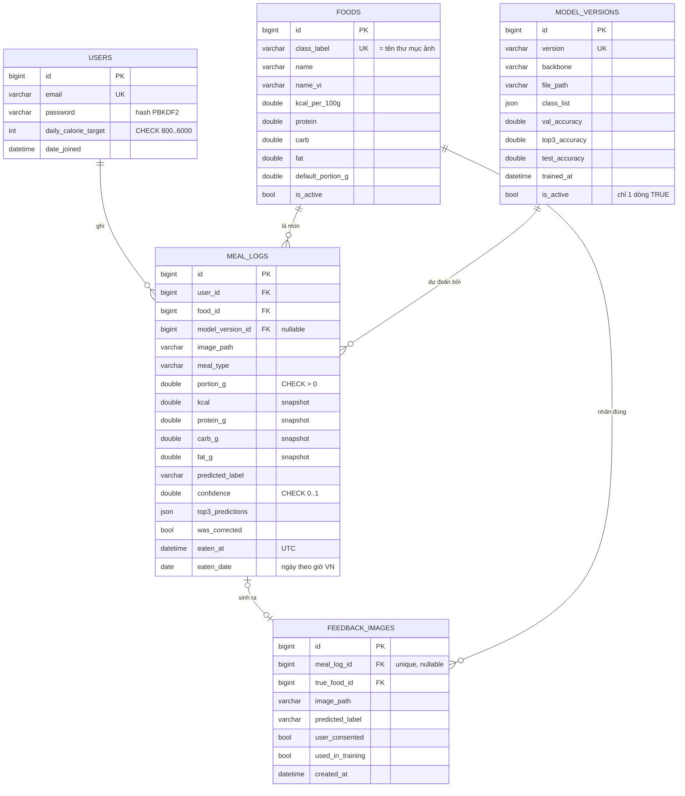

# Thiết kế cơ sở dữ liệu

CSDL chính: **MySQL 8.0** (≥ 8.0.13). Có thể chạy thử bằng SQLite chỉ với việc đổi `DATABASE_URL`.
Mọi bảng được tạo bằng Django migrations (`apps/*/migrations/`), không viết SQL tay.

## ERD



## Quan hệ và hành vi khi xóa

| Quan hệ | Kiểu | ON DELETE | Lý do |
|---|---|---|---|
| users → meal_logs | 1–N | CASCADE | Xóa tài khoản thì xóa nhật ký cá nhân. |
| foods → meal_logs | 1–N | PROTECT | Không được xóa món đã có người ăn; muốn ẩn thì đặt `is_active = false`. |
| model_versions → meal_logs | 1–N | SET NULL | Xóa model cũ không làm mất nhật ký. |
| meal_logs → feedback_images | 1–1 (tùy chọn) | SET NULL | Người dùng xóa bữa ăn nhưng ảnh train vẫn giữ (ảnh có bản copy riêng trong `media/feedback/`). |
| foods → feedback_images | 1–N | PROTECT | Nhãn đúng là khóa ngoại, không thể gõ sai tên nhãn. |

## Ràng buộc và index

| Bảng | Ràng buộc / Index | Mục đích |
|---|---|---|
| users | `UNIQUE(email)`, `CHECK(800 ≤ daily_calorie_target ≤ 6000)` | Đăng nhập bằng email; chặn dữ liệu vô lý ngay ở CSDL. |
| foods | `UNIQUE(class_label)`, `CHECK` dinh dưỡng ≥ 0, khẩu phần > 0 | `class_label` nối thư mục ảnh ↔ CSV ↔ output model. |
| meal_logs | `INDEX(user_id, eaten_date)` | Tổng kcal theo ngày/tuần của 1 người. |
| meal_logs | `INDEX(user_id, eaten_at)` | Danh sách bữa ăn gần nhất. |
| meal_logs | `INDEX(model_version_id, was_corrected)` | Thống kê độ chính xác theo phiên bản model. |
| meal_logs | `CHECK(portion_g > 0)`, `CHECK(kcal ≥ 0)`, `CHECK(confidence IS NULL OR 0 ≤ confidence ≤ 1)` | Toàn vẹn dữ liệu. |
| feedback_images | `INDEX(used_in_training, user_consented)` | Script export lọc ảnh chưa dùng. |
| feedback_images | `CHECK(used_in_training = false OR user_consented = true)` | Không bao giờ train trên ảnh chưa được đồng ý. |
| model_versions | `UNIQUE(version)`, **functional unique index** trên `CASE WHEN is_active THEN 1 END` | Tại một thời điểm chỉ có đúng 1 model active. |

## Các quyết định thiết kế (để trình bày khi bảo vệ)

1. **Chỉ 1 model active trên MySQL.** PostgreSQL/SQLite có *partial index* (`UNIQUE ... WHERE is_active`), MySQL thì không.
   Giải pháp: functional index (MySQL ≥ 8.0.13) trên biểu thức `CASE WHEN is_active THEN 1 ELSE NULL END`.
   Dòng active cho giá trị 1, các dòng khác cho NULL; unique index cho phép nhiều NULL nên chỉ có đúng một giá trị 1.
   Việc chuyển model active dùng 2 câu UPDATE trong một transaction (`ModelVersion.activate()`).
2. **Cột `eaten_date` riêng.** Django lưu `eaten_at` theo UTC. Gom nhóm theo ngày giờ Việt Nam bằng `TruncDate`
   trên MySQL cần hàm `CONVERT_TZ` và bảng múi giờ, mà MySQL trên Windows mặc định không có (kết quả trả về NULL).
   Lưu sẵn ngày theo giờ VN (tính trong `save()`) giúp `GROUP BY eaten_date` đúng, đơn giản và đánh index được.
3. **Snapshot dinh dưỡng trong meal_logs.** `kcal`, `protein_g`… được lưu lúc ghi nhật ký. Admin sửa bảng `foods`
   sau này không làm thay đổi lịch sử. Đây là phi chuẩn hóa có chủ đích (dữ liệu lịch sử).
4. **`predicted_label` dạng text, không phải FK.** Model có thể đoán ra nhãn chưa có trong bảng `foods`
   (ví dụ model cũ có lớp đã bị xóa); text giữ nguyên đúng thứ model trả về.
5. **`top3_predictions` dạng JSON.** Dùng để tính top-3 accuracy thực tế từ phản hồi người dùng.
6. **utf8mb4 + strict mode.** utf8mb4 lưu đủ tiếng Việt; `STRICT_TRANS_TABLES` khiến MySQL báo lỗi thay vì
   tự cắt chuỗi hoặc ép kiểu sai.
7. **Ràng buộc đặt ở CSDL, không chỉ ở form.** Validator của Django chỉ chạy khi đi qua form; CHECK/UNIQUE/FK
   bảo vệ cả khi ghi bằng script, shell hay SQL trực tiếp. Có test riêng: `tests/test_db_constraints.py`.
8. **Phân quyền ở tầng truy vấn.** Mọi truy vấn nhật ký đều lọc `user_id = <người đang đăng nhập>`; sửa/xóa bữa
   của người khác trả về 404 (không lộ là bữa ăn đó tồn tại).

## Truy vấn thống kê

Viết bằng Django ORM trong [apps/diary/stats.py](../apps/diary/stats.py). Django dịch sang SQL tương ứng với
từng CSDL (MySQL/SQLite). Dưới đây là SQL tương đương (`?` là tham số):

**Tổng dinh dưỡng một ngày** (`day_summary`) — dùng index `(user_id, eaten_date)`:

```sql
SELECT SUM(kcal), SUM(protein_g), SUM(carb_g), SUM(fat_g), COUNT(*)
FROM meal_logs WHERE user_id = ? AND eaten_date = ?;
```

**kcal từng ngày trong tuần** (`daily_series`). Ngày không có dòng nào được bù 0 ở Python:

```sql
SELECT eaten_date, SUM(kcal) AS kcal, SUM(protein_g), SUM(carb_g), SUM(fat_g), COUNT(*) AS n
FROM meal_logs
WHERE user_id = ? AND eaten_date BETWEEN ? AND ?
GROUP BY eaten_date ORDER BY eaten_date;
```

**Món ăn nhiều nhất** (`top_foods`), có JOIN sang `foods`:

```sql
SELECT f.id, f.name_vi, COUNT(m.id) AS times, SUM(m.kcal) AS kcal
FROM meal_logs m JOIN foods f ON f.id = m.food_id
WHERE m.user_id = ? AND m.eaten_date BETWEEN ? AND ?
GROUP BY f.id, f.name_vi
ORDER BY times DESC, kcal DESC LIMIT 5;
```

**kcal theo bữa** (`meal_type_breakdown`):

```sql
SELECT meal_type, SUM(kcal) FROM meal_logs
WHERE user_id = ? AND eaten_date BETWEEN ? AND ? GROUP BY meal_type;
```

**So với mục tiêu:** tỷ lệ `kcal / users.daily_calorie_target`. Dưới 90% là *chưa đủ*, 90–110% là *đạt*,
trên 110% là *vượt*. Trung bình tuần chỉ chia cho **số ngày có ghi nhật ký**, để ngày quên ghi không kéo trung
bình xuống.

Muốn xem SQL thật Django sinh ra: `python manage.py shell`, rồi `print(queryset.query)`.

### Độ chính xác của model (từ phản hồi người dùng)

Viết trong [apps/recognition/stats.py](../apps/recognition/stats.py). "Đúng" = `was_corrected = 0`: người dùng
giữ nguyên món model đoán top-1. Chỉ tính bữa ăn do AI nhận diện (`predicted_label <> ''`), không tính bữa
thêm thủ công.

**Tỷ lệ đoán đúng/sai tổng thể** (`overview`):

```sql
SELECT COUNT(*) AS n,
       COUNT(CASE WHEN was_corrected = 0 THEN 1 END) AS correct,
       AVG(confidence) AS avg_conf,
       COUNT(CASE WHEN confidence < 0.6 THEN 1 END) AS below_threshold
FROM meal_logs WHERE predicted_label <> '';
```

**So sánh các phiên bản model** (`model_comparison`). LEFT JOIN để model chưa ai dùng vẫn hiện; dùng index
`(model_version_id, was_corrected)`:

```sql
SELECT mv.version, mv.val_accuracy, mv.test_accuracy,
       COUNT(m.id) AS n,
       COUNT(CASE WHEN m.was_corrected = 0 THEN m.id END) AS correct,
       AVG(m.confidence) AS avg_conf
FROM model_versions mv
LEFT JOIN meal_logs m ON m.model_version_id = mv.id AND m.predicted_label <> ''
GROUP BY mv.id, mv.version, mv.val_accuracy, mv.test_accuracy
ORDER BY mv.trained_at;
```

**Độ chính xác theo nhóm độ tin cậy** (`confidence_buckets`): GROUP BY trên một biểu thức `CASE`:

```sql
SELECT CASE WHEN confidence < 0.2 THEN 0 WHEN confidence < 0.4 THEN 1
            WHEN confidence < 0.6 THEN 2 WHEN confidence < 0.8 THEN 3 ELSE 4 END AS bucket,
       COUNT(*) AS n, COUNT(CASE WHEN was_corrected = 0 THEN 1 END) AS correct
FROM meal_logs WHERE predicted_label <> '' AND confidence IS NOT NULL
GROUP BY bucket ORDER BY bucket;
```

**Cặp hay nhầm nhất** (`top_confusions`):

```sql
SELECT m.predicted_label, f.name_vi, COUNT(*) AS n
FROM meal_logs m JOIN foods f ON f.id = m.food_id
WHERE m.was_corrected = 1
GROUP BY m.predicted_label, f.class_label, f.name_vi ORDER BY n DESC LIMIT 10;
```

**Top-3 accuracy thực tế:** cần xem món đúng có nằm trong mảng JSON `top3_predictions` không. Cú pháp truy vấn
JSON khác nhau giữa MySQL (`JSON_CONTAINS`/`JSON_TABLE`) và SQLite (`json_each`), nên phần này lấy 3 cột cần thiết
rồi đếm bằng Python. Đây là đánh đổi có chủ đích: giữ code chạy được trên cả 2 CSDL.

**Ảnh phản hồi chờ xuất** (`export_feedback`), dùng index `(used_in_training, user_consented)`:

```sql
SELECT fi.id, fi.image_path, f.class_label
FROM feedback_images fi JOIN foods f ON f.id = fi.true_food_id
WHERE fi.user_consented = 1 AND fi.used_in_training = 0 AND f.is_active = 1;
-- sau khi chép file:
UPDATE feedback_images SET used_in_training = 1 WHERE id IN (...);
```
